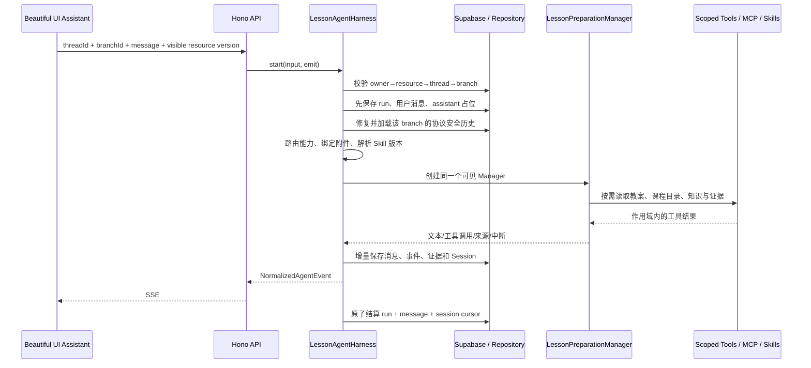
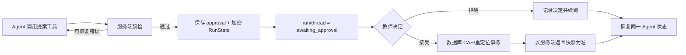

# LessonUp 当前 Agent 运行基线

> 记录日期：2026-08-18  
> 状态：**迁移前归档基线，不代表当前生产实现。**  
> 目的：固定被 Pi 替换前的 `@openai/agents` 业务语义，供迁移回归审计。当前实现见 `pi-agent-harness-migration.md`。

## 1. 当前系统的职责边界

当前 Agent 并不是由 OpenAI Agents SDK 独自承载。系统分成三层：

1. **LessonUp 业务控制面**：账号与资源校验、线程/分支、运行租约、知识作用域、证据、审批、文档事务和前端事件。
2. **OpenAI Agents SDK 运行内核**：单次 Agent 循环、工具调用协议、Session 接口和可序列化的审批中断状态。
3. **模型与工具提供方**：由 `MODEL_*` 配置的 OpenAI-compatible 模型、LessonUp Function Tools、知识 MCP、Web MCP 和版本化 Skills。

因此，替换底层 SDK 时不能删除第一层。`Supabase + LessonRepository` 才是产品数据和连续性的事实来源。

## 2. 一次普通对话的完整链路

入口为 `POST /api/agent/threads/:id/runs`，服务端通过 SSE 返回规范化事件。



关键顺序：

1. `LessonAgentHarness.start()` 等待 Skill registry 就绪，并恢复过期运行。
2. 拒绝同一线程上的第二个 `queued/running/awaiting_approval` 运行。
3. 验证用户拥有的 notebook、lesson file 或 semester framework、thread、branch 以及可见资源版本。
4. 在启动模型和 MCP 之前，持久化 run、用户消息和 assistant 占位；刷新或断线不会重复写入用户消息。
5. 修复 Session 中不完整的 reasoning/tool-call/tool-result 协议单元。
6. 基于用户意图、当前文档、结构化教学依据和附件生成确定性的 `CapabilityPlan`。
7. 将本次附件、Agent 定义版本、Skill 版本、能力计划和运行租约固定到 run。
8. 创建一个可见的 `LessonPreparationManager`。课程、学习设计、评价和批判 Agent 只作为内部工具，不形成第二条可见对话。
9. Manager 在同一轮工具循环中按需读取教案和知识，不默认把完整私有文档或知识库塞进系统提示词。
10. 只向浏览器投影安全的文本、工具标签、来源、审批和终态事件。
11. 成功、失败、取消或等待审批时，将消息、Session 游标和运行状态持久化为可恢复状态。

## 3. 教案上下文是如何交给 Agent 的

当前做法不是每轮把全量教案永久注入对话历史：

- Pi transcript 只持久化教师原始消息；当前资源类型与版本、active section、selection hint、附件和本轮完成条件通过临时 `lessonup_turn_context` 提供，不进入后续轮次的历史。
- Agent 通过确定性文档工具按需读取 outline、section 或完整 document。
- 工具 schema 按当前 CapabilityPlan 最小化注入；轻量对话不携带工具，演示任务只携带教案读取、Dashi 布局和提案工具。
- 运行开始时的路由器可以读取服务端规范文档来决定能力，但这份路由输入不等于给模型重复生成一次内容。
- 文档修改必须基于本轮读取到的规范快照和证据提出 patch。

这能避免旧教案副本长期污染会话，也保证每一轮看到的是当前账号、当前资源、当前版本。

## 4. 账号、资源和会话隔离

隔离键不是单一 `sessionId`，而是完整作用域：

```text
ownerId
  └─ notebookId
      └─ lessonFileId | semesterFrameworkId
          └─ threadId
              └─ branchId
                  └─ runId
```

现有防线包括：

- API 从 Supabase access token 取得 `userId`，不接受客户端自报 owner。
- 仓储查询始终带 `owner_id`，数据库表启用 RLS。
- 开始运行前重新验证 `auth.user → notebook → resource → thread → branch`。
- `RepositorySession` 使用 `ownerId + threadId + branchId` 读取和写入历史。
- 活跃运行在进程内使用 `userId:runId` 标识，数据库另有租约、心跳和唯一活跃运行约束。
- MCP token 由服务端签发，知识作用域由服务端派生，模型不能自行扩大范围。
- 模型凭证、MCP 凭证和私有来源正文不会进入浏览器。

## 5. 会话、分支和长期连续性

### 原始历史

`agent_messages` 保存教师可见消息，`agent_session_items` 保存模型协议历史。二者分开，因为 UI 消息不能完整表达 tool call/result 和 provider 协议项。

### 分支

从一条消息创建分支时：

1. 验证 fork 消息属于同一 owner、thread 和父 branch。
2. 使用消息的 `sessionCursor` 继承准确的协议安全历史。
3. 复制 fork 点之前的可见消息。
4. 仅在摘要游标位于 fork 点之前时继承长期摘要。
5. 父分支保持不变。

### 压缩

旧历史压缩为版本化、非可信结构化摘要；近期消息和完整 tool call/result 单元仍保留。摘要只是上下文材料，不拥有业务真相。

### 失败续跑

失败前已生成的文本保存为 visibly failed draft。已完成且资源版本仍有效的工具结果可以在续跑中复用；不完整、陈旧或当前运行专属的证据必须重读。

## 6. 知识关联与证据连续性

每个 lesson-file run 可访问的知识范围由服务端确定：

```text
public
user:<ownerId>
notebook:<notebookId>
file:<lessonFileId>
```

核心约束：

- 上传资料异步处理，只有所有 chunk 与 embedding 成功提交后才发布为 ready。
- chunk 使用稳定 ID，便于重试、引用和版本判断。
- 附件绑定到具体 user message 和 run；只有本轮 `read_attached_source` 的读取才能支持引用、摘要或判断。
- MCP 每次读取都记录 run evidence。
- 来源只能展示在拥有它的 assistant response 上。
- 带事实陈述的 patch 引用必须来自当前 run 实际观察到的 evidence。
- 课程目录与课程标准是平台知识；私有库不会因为同一账号存在就自动注入另一个 lesson file。

这部分是迁移的最高优先级：新的运行内核可以改变消息格式，但不能改变作用域推导、稳定来源 ID、run evidence 和版本新鲜度规则。

## 7. 写入和审批链路

普通咨询不写文档。写入工具只产生提案，并经过输入 guardrail、资源范围、字段类型、快照、证据和目标文本预检。



审批具备：

- 24 小时有效期；
- Agent/Skill 版本固定；
- 决定和续跑租约幂等；
- 文档事务、审批状态和 RunState 续跑可恢复；
- 非重叠人工编辑可以重定位后保留，目标内容变化或歧义才构成冲突；
- 最终 Dashi goal 审批通过后才进入渲染；不存在独立展示脚本或审批后的内容改写。

## 8. 取消、断线和异常恢复

- 显式停止写入 `cancel_requested_at`，中止当前运行，并最终持久化为 `cancelled`。
- SSE 断开不等于取消；服务器拥有 run，刷新后通过 activity/events 恢复 UI。
- 租约和心跳防止多进程重复执行；过期运行由恢复函数结算。
- Session 写入支持幂等 append；审批续跑使用 buffered session transaction，只有稳定结果才整体提交。
- 失败时不向浏览器暴露 provider 原生事件、raw tool JSON、提示词、凭证或推理内容。

## 9. 前端契约

前端只依赖 `NormalizedAgentEvent`：

- `run.started`
- `message.delta` / `message.completed`
- `tool.started` / `tool.completed`
- `source.added`
- `approval.required` / `approval.decided`
- `document.updated` / `resource.updated`
- `run.completed` / `run.cancelled` / `run.failed`

底层 SDK 的事件名和消息结构不能直接穿透到 UI。新运行内核必须继续输出同一规范事件，才能在迁移期间做到前端无感切换。

## 10. 当前 OpenAI Agents SDK 耦合点

需要替换，而不是保留的部分：

- `server/agent/harness.ts` 中的 `Runner`、streamed result、interruptions 和 `RunState`。
- `server/agent/manager.ts` 中的 `Agent`、agent-as-tool 和 output guardrail 接线。
- `server/agent/tools.ts` 及各业务工具中的 SDK `tool()` 包装。
- `server/repository.ts` 中 `RepositorySession implements Session` 的 SDK 类型。
- `server/agent/session-history.ts` 中 OpenAI `AgentInputItem` 协议修复。
- `server/tracing.ts` 和 `server/app.ts` 中的 SDK tracing 接线。

不应随 SDK 删除的部分：

- Hono API 与 `NormalizedAgentEvent`；
- Supabase 表、RLS、租约、幂等和资源 CAS；
- LessonRepository 的业务数据能力；
- CapabilityPlan 的业务语义；
- 文档/课程/知识/证据/展示业务工具的核心实现；
- 版本化 Skills 及其平台白名单；
- 前端线程、分支、来源、审批和恢复交互。

## 11. 替换完成的等价性门槛

只有以下行为全部在新内核集成测试中成立，旧 Agent 才能删除：

1. 账号和完整资源链隔离。
2. 每个 `thread + branch` 独立历史，fork 精确继承且不修改父分支。
3. 同一运行的按需教案读取、私有知识作用域、附件绑定和来源证据链。
4. 工具协议在成功、失败、取消和重启后仍可继续。
5. 审批可跨刷新和进程重启恢复，决定与文档事务幂等。
6. 文档版本冲突和非重叠编辑重定位语义不退化。
7. 失败草稿、取消、租约恢复和 SSE 重连不退化。
8. 浏览器只能看到规范化安全事件。
9. 当前教案、课堂编导原则与 Dashi 真实版式在同一 Pi tool loop 中形成唯一最终 goal，确认后原样渲染。
