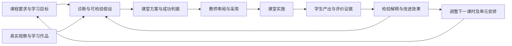

# LessonUp：面向学习结果的 Agent 与业务架构

## 产品目标

LessonUp 应当帮助教师持续改善学生的理解、运用与迁移，同时降低教师的设计和判断负担。教案、学期规划和课件承载这些判断，但生成或采用一份材料本身不能证明教学有效。

“国家级教育专家”应转化为可检验的能力：准确理解学科与课程要求，诊断具体学习困难，比较解释与方案，把判断落实为课堂行动，依据真实学生表现修正判断，并清楚说明证据、适用条件和不确定性。角色名称、提示词长度或模型自评分不能证明达到这一水平。

教育方向参考教育部关于课程目标、学业质量、实践和跨学科活动的[2022 年课程方案与课标说明](https://www.moe.gov.cn/fbh/live/2022/54382/sfcl/202204/t20220421_620077.html)。学习策略参考 IES/WWC 的[学习与教学组织指南](https://ies.ed.gov/ncee/wwc/PracticeGuide/1)，其建议包括间隔学习、示例与练习结合、检索练习和解释性问题，并分别标明证据强度。这些是方法依据；具体课程条款和具体班级判断仍须读取当前资料，不能由通用方法代替。

## 当前项目概览

| 层次 | 已有能力 | 对目标的意义 |
| --- | --- | --- |
| 工作台 | 备课本、学期框架、课时蓝图、A4 教案、Dashi 演示 | 可编辑、可采用的教学交付物 |
| 资料 | 教材目录、知识网络、国家课标、私有资料、联网检索 | 课程与内容的可追溯依据 |
| Agent | 一个原生 Pi 协调器、配置模型、分支历史、流、取消、恢复 | 连续地探索问题与调用业务能力 |
| 业务控制面 | 身份与资源链、证据记录、审批、CAS、幂等交付 | 防止越权、重复写入及覆盖教师修改 |
| 教学反馈 | 观察、练习缺口、错因、衔接效果、部分框架回写 | 开始连接实施后的真实情况 |
| 学习验证 | 目标、任务、判据、群体、来源、观察、干预、实施、复测与审议 | 已有可操作且可追溯的产品闭环；实际学习成效仍须真实课堂检验 |

## 核心问题与处理取舍

| 问题 | 当前处理 | 保留的边界 |
| --- | --- | --- |
| 目标、过程、评价、批判、整份编写 Skill 内容交叠；需额外读取才能获得基本教学规范 | 合并为缓存前缀中的 `education-policy.ts`，删除五份 Skill 与清单 | Dashi 有独立资源、版式及导出合同，继续单独版本化 |
| 四种内部专家工具重新读取规范全文，并发起不共享证据工具的同模型请求 | 删除额外模型工具与专家路由字段；统一 Agent 比较解释和反例 | 不把同模型的另一份答案宣称为独立专家验证 |
| 关键词决定课程、知识、依据、联网工具是否存在，遗漏词汇就失去调查能力 | 普通教学任务按当前资源提供稳定工具集合；配置可用时提供联网 | Fast 仍为零工具；Dashi 保持独立紧凑工具面；写入受当轮策略约束 |
| 设计依据只返回基础记录，教案工具没有读取课堂反馈的能力 | 业务读取服务组合单元、蓝图、前后课时、当前及前序反馈，工具仅适配 | 上游资源必须同账号、同备课本、同单元；返回版本与失效状态 |
| 反馈上下文随学期数据增长，容易重复加载或扩大到未来课时 | 最近三个前序课时，每课时八条最新记录，显式标记截断；加蓝图查询索引 | 这是局部诊断视图，不代表整学期或全部学生；需要更广证据时应另行检索 |
| 评测要求不存在的工具，且仅启动工具也可能满足门禁 | 移除过期工具要求，增加实际工具面契约测试；必需工具须成功完成 | 失败后成功修复可通过，禁止写入的尝试即使失败也不通过 |

身份隔离、分支、历史压缩、审批决定、交付、续答、同步不是重复抽象。它们分别约束不同的持久化事实，不能为了减代码合成一个 `status` 或一个任意写入工具。

`read_document(fields)`、`read_section` 和 outline 虽有语义交集，但分别控制多栏目、单栏目及无正文读取的成本，暂保留。结构化设计依据写入、A4 写入和演示生成也各有事务与版本语义，不能合并成没有约束的通用 JSON 写入。

## 目标工作方式

这是产品事实之间的关系，不是要求模型每次执行同一套步骤。简单问题直接回答；复杂问题由最关键的不确定性决定读取、搜索、比较、设计检查或修改的顺序。

Agent 负责理解意图、提出假设、选择工具、比较方案和解释取舍。业务服务负责规范资源、版本、证据归属和变更。Pi 负责唯一模型循环，D1/R2 负责事实，前端负责交付与编辑。不要再创建平行 harness、隐形专家链或第二份长期工作流真相。

## 已落地的学习闭环

课时侧栏的“学习验证”将观察与推断分开保存：

1. 教师记录目标、任务、成功判据、观察群体、时间、作品或观察来源、实际表现，按需记录观察人数和达标人数。证据不可变，不用模型生成观察。
2. 同一 Pi Agent 先读取指定证据，保存主要解释、替代解释、调整、预期信号和复测办法；教师也可自行记录。方案通过原运行成功交付后才可见和采用。
3. 教师分别采用、确认实际实施时间；采用不会自动改写 A4 或标记已实施。需要改教案时仍使用原有文档提案、版本与审批合同。
4. 实施后记录绑定该方案的真实复测；时间不能早于实施。目标、成功判据或群体不可比时，只能作“证据不足”判断。界面可在同一表单核对基线与后测的任务、判据、群体、来源和人数。
5. Agent 仅提出审议建议；教师最终记录符合预期、未见预期或证据不足，并说明依据和限制。不可把这些状态称为因果验证。
6. 已审议的复测可直接成为下一轮诊断起点。当前及同单元最近三个前序课时的已审议结果，由组合教学上下文直接读取原记录，不复制一份反馈。保留反例、替代解释与局限，服务后续课时设计。

`server/learning/service.ts` 定义业务规则，应用端口隔离 D1/内存实现。SQL 写入同时保存规范记录、不可覆盖的方案版本历史与命令回执；CAS 保护并发决定和教案版本，幂等键保护重试。保存响应丢失时先查原回执；未确认的请求保持原标识和输入，避免重复建立记录。Agent 未完成或已取消的方案不会成为可采用结果。

读取默认40条证据、24项方案，并提供基于时间与 ID 的索引游标分页。指定业务动作另有精确读取，即使选择超出默认窗口也能取得原始基线或后测；窗口截断不能成为编造依据的理由。

## 完成条件与授权

已加入 `complete_without_change`：成功读取规范内容后，可说明现稿足够或证据缺口，不为了满足完成门禁硬造修改。它与任何提案互斥，界面显示无变更结果，条件式评测允许这条路径，但仍要求指定读取和实质理由。

学习验证入口携带结构化 `taskIntent`，绑定证据、方案和版本，明确只允许提出学习建议；普通对话的语言路由仍作为兼容入口。教案、设计依据、框架和演示的实际交付继续分别走各自事务与审批，不把业务动作合成无限制写入工具。

## 专业能力的验证边界

工程闭环已经可以运行，但不能由此宣称达到国家级教育专家水平。仍需跨学科、学段和真实课堂案例，覆盖资料冲突、无证据、特殊学习需要、失败干预和长期迁移。由教育专家盲评并校准评分尺度，追踪教师工作量及真实学生的独立、延迟与迁移表现；同模型 grader 只做筛查。

专业规范明确区分提示下答对、独立掌握、保持与迁移。若一项调整同时改变多个条件，仅凭前后变化不能区分解释；需保留替代解释和限制。系统保存这些判断的证据链，但不自动把学生贴上长期能力标签。

## 性能与可靠性

已减少的确定性成本：教学任务无 Skill 读取模型往返，无内部专家二次推理；普通工具 schema 稳定；基础文档和依据并行加载；组合教学上下文避免模型自行串行拼接，反馈与学习记录查询有界且有索引。同版本可用的读取仍应复用，原始对话与完整工具组继续保存。

稳定工具面会增加原本简单 Agent 请求的 schema 大小，缓存收益必须通过实际供应商的 cached-input 指标和端到端延迟验证，不能仅凭架构推断更快。

前端已修复两项确定性开销：静置课件查询从每1.5秒改为30秒（生成中仍为1.5秒），隐藏页面停止轮询，焦点和状态变化触发刷新；未变化的课件保持对象身份，避免无意义触发 A4 测量。修正 vendor 匹配误把 `@base-ui/react` 算入 React 核心包的问题，Tiptap 独立按需加载，生产首页不预加载编辑器；React vendor 从约668 KB降至194 KB。包大小变化不等于端到端性能或帧率证明。

尚需基准数据支撑的风险：

- 课标检索仍最多读取 1,000 个候选并在应用侧排序，带向量时数据传输明显增加；私有知识检索仍扫描最多 1,500 条候选。应依据真实数据量引入 SQL 倒排/向量召回和重排，保留发布版本、权限过滤、中文召回及检索回归，不能先缩小候选窗口来制造速度提升。
- `getSemesterFramework` 仍读取完整框架再投影局部蓝图；大规模学期需要仓储侧的局部读取及批量关联。
- 学期反馈工具仍返回全量记录；下一步需有按目标、课时与时间的检索和精确反馈定位，再收紧默认窗口，避免遗漏待回写反馈。
- 流式 UI 与 A4 分页的卡顿需要浏览器实际 trace、长文档和持续流输入测试。构建体积或后端单元测试不能证明帧率。
- 长文档压力测试已加入：4倍CPU降速、约4,700字和7页，覆盖持续草稿、输入、采用分页一致性及取消恢复。已通过CPU采样定位并减少 schema 重建、只读草稿编辑器及同步分页探针。初次打开仍有明显主线程工作，不能据单机场景声称全设备无卡顿；用 `npm run test:e2e:performance` 持续记录，并按产品目标显式配置浏览器预算。

测量至少区分：请求接收、首个模型事件、首个可用文本/草稿/确认项、工具耗时、审批前交付完成、采用后同步、模型请求数、缓存命中、上下文量和浏览器长任务。收集按任务类型分组的 p50/p95，再制定发布预算；不能用一个快速出现的“正在处理”事件掩盖实际等待。

专业评测现有独立的[人工盲评工具与规则](professional-review.md)：导出规范快照与成果，隐藏自动成绩和模型元数据，检查两位人工评审的覆盖、大分歧及严重问题。工具完成不表示已有专家评分；实际课堂独立、延迟与迁移证据仍需采集。

运行 `npm run typecheck`、`npm run typecheck:cloudflare`、`npm test`、`npm run build` 和相关浏览器契约测试验证工程行为。原生 Pi 集成测试使用可控 provider，证明协议、工具及隔离；真实模型能力与延迟另用 `npm run eval:agent` / `npm run eval:agent:release` 验证。迁移为 `0022`（反馈索引）及 `0023`（学习证据、方案、索引和版本历史）；本地迁移已验证，远程迁移与部署须另行执行。`npm run eval:learning:smoke` 另用配置模型与隔离合成数据验证原生工具行为，不能替代真实课堂成效验证。
