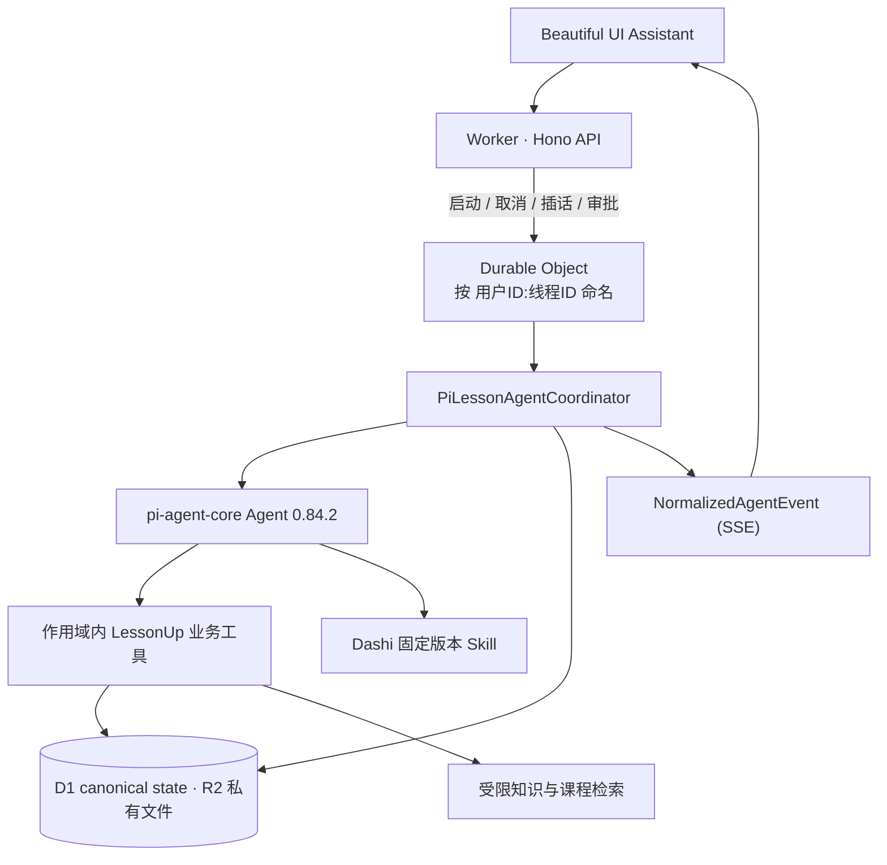
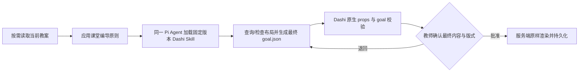

# LessonUp Pi Agent 迁移与当前架构

> 更新日期：2026-10-17
> 平台：Cloudflare Workers + Durable Object + D1 / R2（2026-08 自 Supabase 迁入，Agent 内核仍为 Pi）
> Pi 版本：`@earendil-works/pi-agent-core@0.84.2` / `@earendil-works/pi-ai@0.84.2`  
> Node 基线：`24.19.x`

## 1. 当前结论

LessonUp 的默认 Agent 运行内核已经从 OpenAI Agents SDK 完整切换为 Pi。旧 SDK、旧 Manager/Harness、旧工具 wrapper 和独立 PPT 内容编译 Agent已从运行路径与直接依赖中删除。

Pi `0.84.2` 发布包中的 `Agent` 本身已经是具备状态、工具执行、事件流、队列与终止能力的完整 Agent 运行对象。LessonUp 现在由 `PiLessonAgentCoordinator` 直接创建和驱动原生 `Agent`，不再保留 `PiAgentRuntime` 或同义的二次运行壳。尚未实现的上层 `AgentHarness` 不进入生产路径。

这不是双运行时或 feature flag 方案：运行入口只创建 `PiLessonAgentCoordinator`（在 Cloudflare 上位于 Durable Object 内），`/api/runtime` 明确返回 `agentRuntime: "pi"`。

## 2. 当前生产结构



运行位置：Worker 只做认证和路由；运行相关请求按 `用户ID:线程ID` 转给 Durable Object `LessonUpAgentRuntime`，由它构造 `PiLessonAgentCoordinator` 并持有本次运行的流、`AbortController` 与 Pi 队列，普通 Worker 实例不构造 Agent。运行租约 30 秒、心跳 8 秒；Durable Object 只保存这些短生命周期对象，D1 才是事实源。每 5 分钟的 cron 让过期审批失效、重新排队租约过期的知识索引，并驱动知识索引队列；过期的运行租约在该线程下一次被访问时恢复（`recoverExpiredRuns`）。

边界原则：

- 一个可见 Agent 贯通同一 `thread + branch` 的教案、知识、脚本、确认和交付。
- D1（私有文件在 R2）而非 Pi 进程内对象或 Durable Object 内存负责账号、资源、消息、运行、审批和知识元数据的事实状态。
- Pi 只注册服务端绑定的教学业务工具；不暴露 shell、任意文件读写、全局 Skill 扫描或本机凭据目录。
- 浏览器只接收规范化文本、公开工具标签、来源、审批与终态事件，不接收推理、工具参数、工具原始结果或私有提示词。

原生事件按如下顺序投影到 UI：`agent_start → turn_start → assistant message start/update/end → tool execution start/update/end → turn_end → agent_end`。公开事件保留阶段、轮次、工具 ID、工具名称和安全展示标签；`args`、`partialResult`、`result`、thinking 块与 provider 原始事件永不出服务端。UI 以这些事件维护 `preparing / responding / using_tools / organizing / settling`，不再根据文本是否出现来猜测状态。

Beautiful UI 只是这组公开事件的呈现层，不拥有 Agent loop，也不维护第二套阶段状态机。教案类提案（A4 正文修改、设计依据落实与联合变更）在生成过程中把工具参数里的正文增量投影为 A4 上的未保存草稿，教师在 A4 底部采用或放弃；草稿不进入自动保存与撤销历史，采用时仍以服务端 canonical 快照和版本校验为准。这类决定不再另起模型续答，其结果作为 `documentDecisions` 进入下一轮的动态上下文。学期框架、课堂演示等其他审批仍以 Approval Card 出现在 Prompt Bar 的交互槽中；确认后只接受服务端 canonical 快照，即使随后的 Pi 确认回复失败，客户端也会重新读取已提交资源，续跑只补回复而不会重写业务数据。

## 3. 账号、资源和会话隔离

每次运行都重新验证完整关系：

```text
user
  └─ notebook
      └─ lesson_file | semester_framework
          └─ agent_thread
              └─ agent_branch
                  └─ run
```

- 客户端 ID 全部视为不可信候选值；Coordinator 与仓储重新验证归属和资源版本。
- `agent_runtime_sessions` 以 `owner_id + thread_id + branch_id + runtime` 保存 revision 头；协议消息逐条追加到 `agent_runtime_session_messages`，其外键绑定 canonical thread/branch。
- 稳定 Pi transcript 使用 revision CAS 提交，避免并发覆盖。
- provider session id 由服务端密钥对 owner/thread/branch 做 HMAC，不使用可枚举原始 ID。
- branch 只继承 fork message 的 `session_cursor` 之前的完整协议历史；父分支保持不变。
- 知识范围由服务端派生（`public`、`user:`、`notebook:`、`file:` 四种作用域），模型参数不能扩大 owner、notebook、file 或 attachment scope。

## 4. 会话连续性与压缩

连续性采用“双轨存储”：

1. `agent_runtime_session_messages` 永久保存完整、协议安全的 Pi 原始历史，用于审计、失败恢复和精确分支。
2. 超过阈值后，运行时把较早历史压成经过 Zod 校验的版本化结构摘要，并保留最近完整 user/assistant/tool-call/tool-result 单元。
3. 模型视图使用“结构化摘要 + 最近原始尾部”；提交时只把本轮新增协议消息追加回完整 canonical history，绝不把摘要替换成伪历史。
4. 摘要保留目标、稳定事实、已确认决定、资源 ID/版本、证据引用、未解决事项和已拒绝/被替代方案；不保留凭据、完整私有正文或模型推理。
5. 摘要内容仍按不可信数据处理，不能作为系统指令、工具授权或写入依据。
6. 分支仅在摘要游标不晚于 fork cursor 时继承摘要；否则从该分支的精确原始历史重新形成记忆。
7. 压缩在后台进行（窗口占用约 60% 时安排）；仅当有效上下文超过窗口约 90% 时才在本轮等待摘要，仍放不下则以 `agent_context_window_exceeded` 失败。

知识事实不会仅依赖“模型还记得”：写入或引用仍需当前 run 的服务端工具读取、来源记录与资源版本校验。

## 5. 业务工具覆盖

同一个 Pi Agent 现已覆盖：

- 教案元数据、完整文档、字段、大纲读取；
- 私有项目知识、附件、passage、来源元数据读取；
- 教材目录、课程标准、知识点、语义关系与连续性读取；
- 学期框架、单元、课时蓝图、课堂反馈与版本读取；
- SSRF 防护的 Web 搜索和页面读取；
- 统一的教学判断规范与有界的上游规划、课堂反馈读取；
- 学习证据分页与精确定位、待采用改进方案和待教师审议的复测建议；
- 读取规范内容后，以保留现稿或说明证据缺口完成，不强制制造修改；
- 普通 A4 教案 patch；
- 教案与结构化设计依据的联合变更、投影和独立维护；
- 学期框架 patch；
- 课堂演示最终 Dashi goal 提案；
- 教师确认后由服务端确定性渲染已校验 goal，不再调用模型改写。

教案、框架和演示变更先在工具输入阶段完成 scope、类型、快照、目标、证据与 CAS 预检，随后只创建一个持久化审批。学习工具仅保存待采用方案或待审议建议，采用、实施和最终判断由教师的明确业务动作提交；不自动修改教案或产生课堂事实。咨询不触发业务交付。

知识与课标检索：教师资料先只读文本并打分，再仅为最相关的候选读取向量重排；课标按笔记本的学科、学段、年级整体排序，并对同一发布版本、范围和查询复用最近结果。查询向量来自配置的嵌入服务，未配置或调用失败时退回文本排序（失败结果不入缓存）。文本排序对不带空格的中文按字符对匹配，因此整句提问也能命中原文。

## 6. 审批与恢复

Pi 0.84.2 没有可用的 Web suspended-operation 实现，因此 LessonUp 使用应用级 durable continuation：

1. Pi 调用 `propose_*` 工具；工具只保存通过预检的提案。
2. Coordinator 先提交完整 Pi transcript，再创建持久化 approval（24 小时有效）。教案类提案让本次 run 直接以 `completed` 结算，其他提案使 run 进入 `awaiting_approval`。
3. 教师决定后，数据库幂等提交或拒绝业务事务。
4. 非教案类审批：同一 `thread + branch` 的 Pi session 接收服务端可信的决定结果并继续。教案类决定不再续答，只写入 `documentDecisions`，并可在教师继续其他对话时独立采用。
5. 刷新、断线或进程重启不会依赖原 Pi 实例；continuation lease 和 idempotency key 阻止重复事务。
6. 若业务事务已提交但确认回复的模型调用失败，重试只补确认回复，不再次写入资源。

旧 OpenAI RunState 不再是运行依赖；迁移前尚未处理的历史审批仍可通过已保存 patch 和数据库决定完成。

## 7. 演示文稿唯一正确流程



约束：

- 课堂编导原则与 Dashi 真实布局约束在同一个 Pi tool loop 中共同形成唯一最终 goal。
- Pi 注入的是 LessonUp 专用的 Dashi Skill 适配契约；通用 Codex Skill 中询问风格、运行 shell、写文件、渲染、版本检查和旧脚本确认规则不进入模型上下文。
- 教师批准的是已经通过 Dashi 原生校验的最终学生可见内容与版式。
- 批准后不再运行 Agent；服务端把批准的 goal 原样交给 Dashi Web 适配层（`BrowserDashiSkill.renderGoal`）确定性渲染，共享的主题与编辑器运行时来自 `public/dashi`。
- props 或 goal 校验失败会作为工具错误返回同一个 Pi Agent，在审批创建前修正。
- 输出由服务端分配 presentation id 和目录，并以幂等 generation record 持久化。
- 工具调用之间的模型工作旁白不作为对话正文发布；界面只展示规范化活动和最终审批卡，避免内部纠错语言污染教师对话。
- 普通对话回复跟随教师最新消息的主要语言，不由中文系统提示、Skill 文本或工具结果强制切换。

因此不存在中间 storyboard、第二次 Agent 编译或审批后的内容改写。

## 8. Pi 能力采用边界

### 提示与上下文分层

- Pi 持久化 transcript 只保存教师原始消息和完整、协议安全的 Agent/tool 消息；资源版本、焦点、选区、附件和本轮完成条件通过服务端生成的临时 `lessonup_turn_context` 注入，不再伪装成教师消息进入长期历史。
- 静态 system prompt 同时包含身份、安全、证据、审批边界和统一教学判断规范；五份教学 Skill 已合并到 `education-policy.ts`，不再额外调用模型读取基本专业方法。
- 轻量对话为零工具，课堂演示保持独立工具面；普通教学任务的文档、课程、资料、依据及已配置联网工具保持稳定。关键词不再决定调查工具是否存在，写入策略和证据要求仍由服务端校验。快车道只接收致谢/确认和指向对话本身的追问；涉及教案或外部事实时走 Agent 车道。
- 完整教案编写、目标、过程、评价与审查共用专业规范；Dashi 是唯一独立 Skill。普通教学和文件采用不依赖 Dashi 清单加载成功。
- 已移除内部 specialist 模型调用。第二意见通过同一 Agent 比较不同解释和反例，不能将同模型的另一份回答宣称为独立专家共识。完整产品目标与待补能力见 [教育 Agent 架构](education-agent-architecture.md)。

| 能力 | 当前采用方式 |
|---|---|
| Streaming / tool loop / abort | Coordinator 直接使用原生 Agent，并把完整生命周期安全投影为 SSE 事件 |
| Provider abstraction | `MODEL_API` 选择 Responses 或 Chat Completions，凭据仅服务端 |
| Tools | TypeBox schema，读写工具均绑定服务端 scope |
| Skills | `SkillRegistry` 仅加载仓库内固定版本 Dashi；教学规范直接内置 |
| Branch / session | D1 canonical transcript + revision CAS |
| Compaction | 版本化、校验、不可信摘要 + 完整原始历史 |
| HITL | LessonUp durable approval/continuation state machine |
| 必须完成的工具提交 | 首次原生 run 返回后，在同一个 Pi `Agent`、同一 transcript 与工具结果上发起显式下一次 `prompt()`；不在 `turn_end` 回调里竞态排队，也不创建第二个 runtime |
| Steer / follow-up | 已开放：Prompt Bar 可在运行中发送“插话”（steer）或“下一轮”（follow_up），经 `POST /api/agent/runs/:id/input` 进入原生 Pi 队列，`DELETE` 可清空。只用于 Turn 执行期间追加的普通用户消息；审批与交互响应不走该队列 |
| Filesystem / bash | 不注册，避免越过 SaaS 资源边界 |

### 8.1 2026-08-20 官方能力审查

当前锁定版本与 Pi `main` 均为 `0.84.2`。官方 `AgentHarness` 类型已经声明完整目标接口，但以下编排方法仍直接返回 `HarnessNotImplemented`：

- `prompt`、`skill`、`promptFromTemplate`；
- `resume`、`abort`、`waitForIdle`、`runWhenIdle`；
- `steer`、`followUp`、`nextRun` 与队列取消；
- `compact`、`navigateTree`、lane 创建/恢复；
- `watch`、`watchSession`、events 与 hooks；
- 带 operation log 的进程崩溃恢复。

因此当前不能诚实地宣称已接入“完整 AgentHarness”。已经真实接入并用于生产的是：

- `@earendil-works/pi-ai` Models/stream provider；
- `@earendil-works/pi-agent-core` 的 `Agent`、并行工具循环、逐工具顺序覆盖、完整事件订阅、abort、waitForIdle、session id、follow-up、上下文变换和协议消息；
- Pi TypeBox 工具协议与 tool result/error 回流；
- Pi 原始 transcript 的持久化、恢复和协议安全裁剪。

Harness 尚未实现的 durability、lane、snapshot、approval suspension 和 storage adapter 由 LessonUp 的 D1 状态机承担。它们是业务控制面，不包装或替代原生 Agent，也不把未实现能力写成已接入。

### 8.2 每轮能力路由原则

工具权限由当前教师消息决定，不从上一个已结束 run 继承。诸如“好的”“收到”属于新的轻量对话轮次，不加载 Dashi 或写入工具。审批只能通过绑定具体 `approvalId` 的审批命令推进；普通文本不能隐式重放上一个副作用任务。

“使用 Pi 本身能力”不等于开放 coding agent 的本机权限。LessonUp 是多租户教学产品，账号与业务资源授权始终高于通用工具便利性。

## 9. 版本与替换策略

- Pi 包精确锁定在 `0.84.2`，避免 0.83 → 0.84 一类破坏性 Harness 重写未经验证进入生产。
- Node 固定为 `24.19.x`，`.nvmrc`、`package.json engines` 与 lockfile 一致。
- `PiLessonAgentCoordinator` 是业务控制面与原生 Pi Agent 的唯一交界；不存在额外 runtime wrapper。
- 当上游 `AgentHarness` 真正可运行且提供本项目需要的 durable Web 编排能力时，再基于实际收益评估迁移；当前不为未实现接口预埋重复抽象。

## 10. 验证门

发布必须同时通过：

- TypeScript 类型检查和生产构建；
- Pi provider 双协议测试；
- 真实 Pi tool-loop、重启连续性、CAS、owner 隔离与 branch 测试；
- 长会话摘要、最近完整协议尾部和 canonical raw-history 测试；
- 教案、设计依据、学期框架和最终 Dashi goal 审批集成测试；
- 同一 Pi session 的 Dashi query/inspect/render 及“批准后不得新增文案”测试；
- 取消、失败草稿、证据、附件、来源和 API 回归测试；
- 本地 `npm run dev`（Wrangler Worker + Vite，本地 D1/R2）和浏览器控制台检查；Worker/服务端改动另跑 `npm run typecheck:cloudflare`；
- `npm run eval:agent:release` 的真实模型业务质量与显式性能预算门。

迁移前的旧运行结构仅保留在 `current-agent-runtime-baseline.md` 作为审计资料，不是当前实现说明。

### 10.1 失败诊断

浏览器只收到公共错误码。运行失败的真实原因以结构化的 `Agent failure` 日志写入 Worker 日志（`source`、`runId`、`threadId`、错误码、错误名称/消息/堆栈与 cause 链），不含教师消息和模型输出；启动路由只记录未被识别为具体公共错误码的失败。排查一次 `agent_run_failed` 时先按 `runId` 查这条日志。

## 11. 上游参考

- Pi 仓库：<https://github.com/earendil-works/pi>
- Agent Core：<https://github.com/earendil-works/pi/tree/main/packages/agent>
- Pi Agent Core changelog：<https://github.com/earendil-works/pi/blob/main/packages/agent/CHANGELOG.md>
- Pi coding-agent session 文档：<https://github.com/earendil-works/pi/tree/main/packages/coding-agent/docs>
